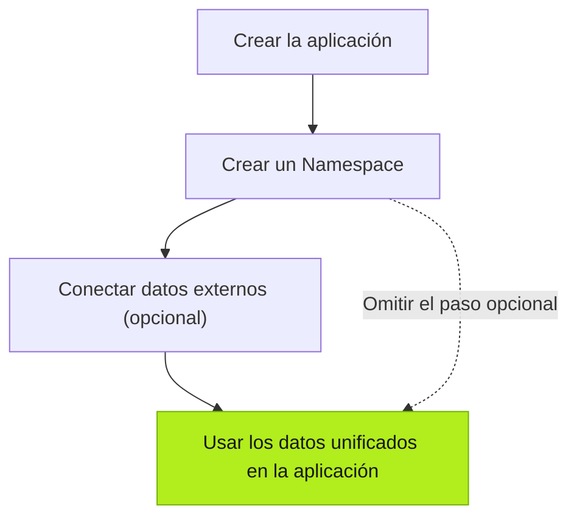

| Acción | Responsable | Descripción |
| --- | --- | --- |
| Crear la aplicación | Tú | Habla con el Agent para crear una aplicación personalizada. |
| Crear un Namespace | Agent | Crea un Namespace y modelos de datos según la lógica de negocio de la aplicación. |
| Conectar datos externos (opcional) | Tú | Si hace falta, proporciona información de sistemas empresariales o dispositivos existentes para que el Agent los conecte. |
| Integrar datos | Agent | Asigna, transforma e integra los datos externos en el modelo existente de la aplicación. |

## Siguiente

- [Crear aplicaciones](../../using-tier0/building-apps/) — Descubre cómo se crean aplicaciones en Tier0.
- [Preparar la base de datos](../../using-tier0/preparing-data-foundation/) — Conoce los modelos de datos y las conexiones externas.
