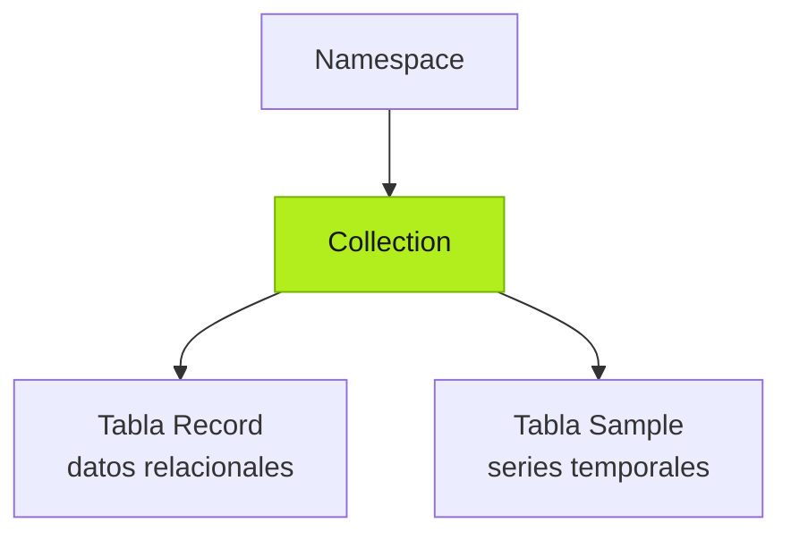
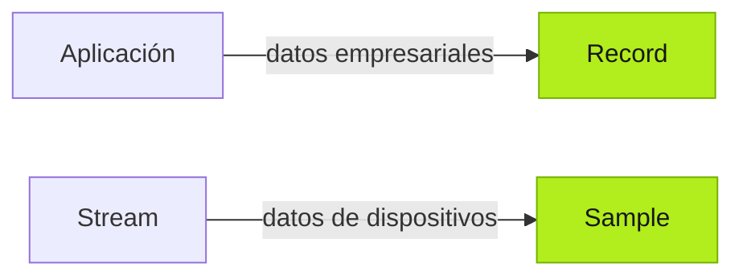
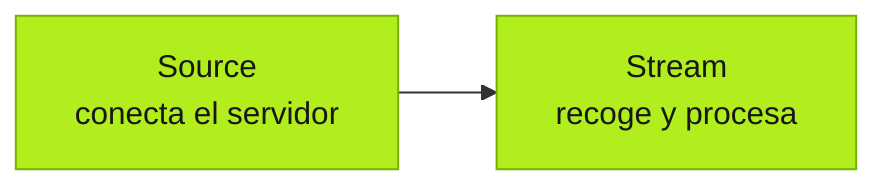

import { Steps } from '@astrojs/starlight/components';

Tier0 establece una base para los datos de aplicaciones personalizadas: recibe datos empresariales de las aplicaciones, conecta sistemas y dispositivos existentes e integra los datos en un modelo unificado que pueden utilizar las aplicaciones.

:::tip[Quién se ocupa de los datos]
- Tú gestionas las conexiones a fuentes de datos, especialmente las que requieren autenticación.
- En Cloud y Enterprise, el Agent se ocupa del resto: adquisición, asignación y modelado de datos.
:::

## Conceptos de los fundamentos de datos

### Namespace

Todos los datos se modelan en **Collections** dentro de **Namespace** y se organizan según su tipo.

- Los datos relacionales, principalmente de sistemas empresariales, se guardan en tablas **Record**.
- Los datos de series temporales, principalmente de dispositivos, se guardan en tablas **Sample**.

### Tipos de datos

Los datos empresariales pueden proceder del uso de la aplicación o de sistemas externos. Los datos temporales suelen proceder de dispositivos conectados.

### Conexión de datos

- **Source**: Conecta con servidores de datos externos, normalmente con autenticación.
- **Stream**: Recoge datos de los servidores, los procesa según los requisitos y los guarda en los modelos de **Namespace**.

## Construir los fundamentos de datos

<Steps>
1. Crea la aplicación en **Builder** y deja que el Agent prepare los modelos empresariales en **Namespace**. Salvo que el prompt indique lo contrario, los genera automáticamente según la lógica empresarial de la aplicación.
	:::note
	Salvo que el prompt indique lo contrario, el Agent genera automáticamente los modelos de datos según la lógica empresarial de la aplicación.
	:::
2. Conecta las fuentes necesarias en **Connect** > **Source** con su autenticación.
3. Pide al Agent que cree un **Stream** para recoger y procesar datos de las fuentes conectadas y guardarlos en los modelos de **Namespace** creados para la aplicación.
</Steps>

:::tip[Comprender el flujo de datos]
Cuando se completa el proceso desde la conexión de la fuente, pasando por el procesamiento en Stream, hasta el modelado y almacenamiento en Namespace, se forma un flujo de datos en **Namespace** > **Data Flow** que muestra el linaje de los datos tanto en Cloud como en Edge.
:::

## Siguiente

- [Crear aplicaciones](../building-apps/) — Crea aplicaciones industriales con datos de UNS.
- [Trabajar con datos de fábrica](../working-with-factory-data/) — Lee y usa los datos conectados.
