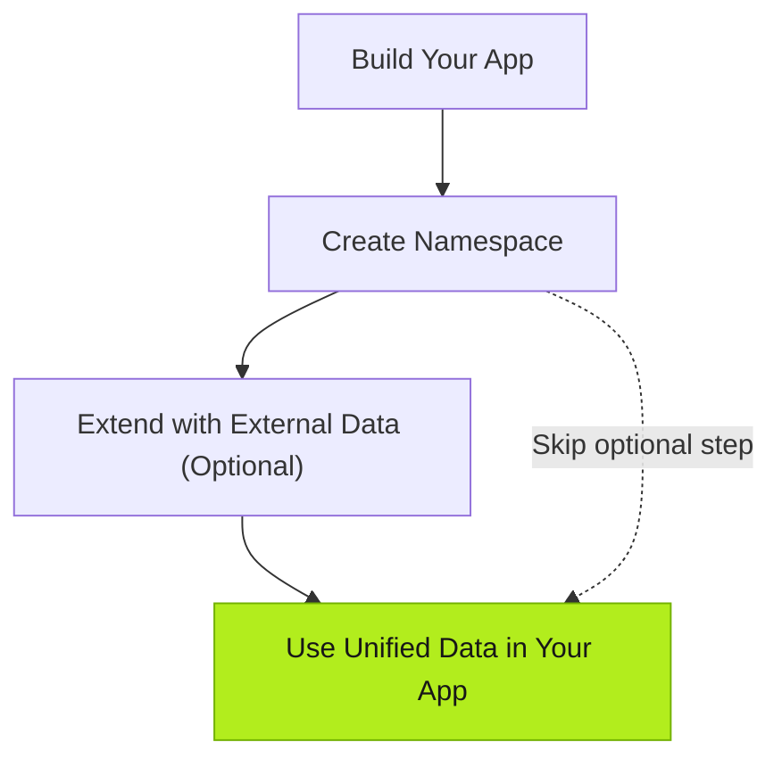

| Action | Operator | Description |
| --- | --- | --- |
| Build App | You | Talk to the Agent to create a custom application. |
| Create Namespace | Agent | Creates a Namespace and data models based on the App's business logic. |
| Connect External Data (optional) | You | Provide information of existing business systems or devices for the agent to connect when necessary. |
| Integrate Data | Agent | Maps, transforms, and integrates external data into the existing model for the App. |

## Next

- [Building Apps](../../using-tier0/building-apps/) - Explore how Apps are built in Tier0.
- [Preparing Data Foundation](../../using-tier0/preparing-data-foundation/) - Learn how data models and external data connections work.
