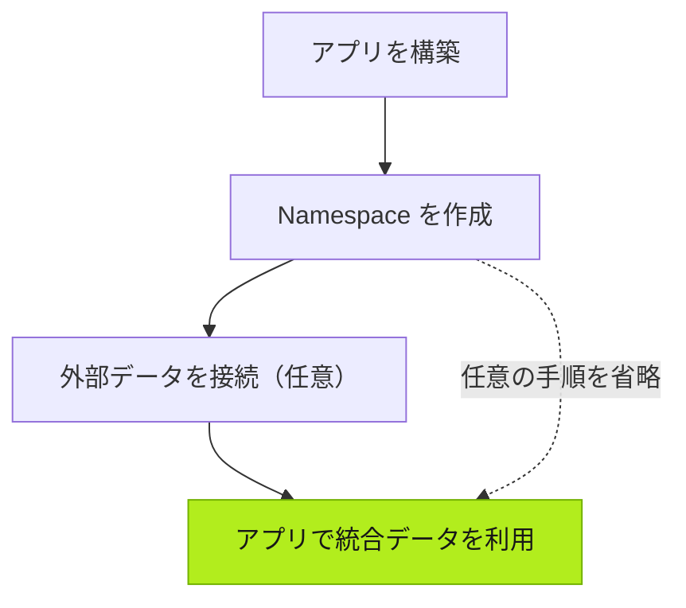

| 操作 | 担当 | 説明 |
| --- | --- | --- |
| アプリを構築 | あなた | Agent と対話してカスタムアプリを作成します。 |
| Namespace を作成 | Agent | アプリの業務ロジックに基づいて Namespace とデータモデルを作成します。 |
| 外部データを接続（任意） | あなた | 必要に応じて、接続する既存の業務システムやデバイスの情報を Agent に提供します。 |
| データを統合 | Agent | 外部データを既存のアプリのモデルにマッピング、変換、統合します。 |

## 次へ

- [アプリの構築](../../using-tier0/building-apps/) — Tier0 でアプリを構築する方法。
- [データ基盤の準備](../../using-tier0/preparing-data-foundation/) — データモデルと外部データ接続について。
