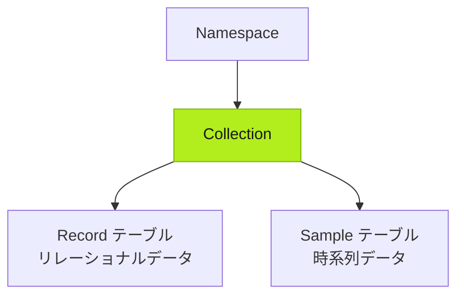
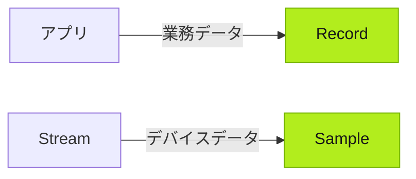
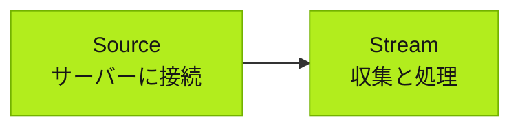

Tier0 はカスタムアプリのデータ基盤を作ります。アプリから業務データを受け取り、既存のシステムやデバイスに接続し、アプリで使える統一モデルにデータを統合します。

:::tip[データ作業の担当]
- データソースへの接続、とくに認証が必要な接続は利用者が行います。
- データの取得、マッピング、モデル化など残りは Agent が行います。
:::

## データ基盤の概念

### Namespace

すべてのデータは **Namespace** 配下の **Collections** にモデル化され、データ型に応じて整理されます。

- 主に業務システムからのリレーショナルデータは **Record** テーブルに保存します。
- 主にデバイスからの時系列データは **Sample** テーブルに保存します。

### データ型

業務データはアプリの利用または外部システムから取得します。時系列データは主に接続したデバイスから取得します。

### データ接続

- **Source**: 外部データサーバーに接続します。認証が必要な場合が多くあります。
- **Stream**: サーバーからデータを収集・処理し、**Namespace** のモデルに保存します。

## データ基盤を構築する

1. **Builder** でアプリを構築し、Agent に **Namespace** の業務データモデルを用意させます。プロンプトで明示しない限り、Agent が業務ロジックからモデルを自動生成します。
2. **Connect** > **Source** で必要なデータソースに接続し、認証を設定します。
3. Agent に **Stream** を作成させ、接続済み Source のデータを収集・処理して、アプリ用に生成された **Namespace** モデルへ保存します。

## 次へ

- [アプリの構築](../building-apps/) — UNS データを利用する産業アプリを構築します。
- [工場データの操作](../working-with-factory-data/) — 接続したデータを読み取り、利用します。
