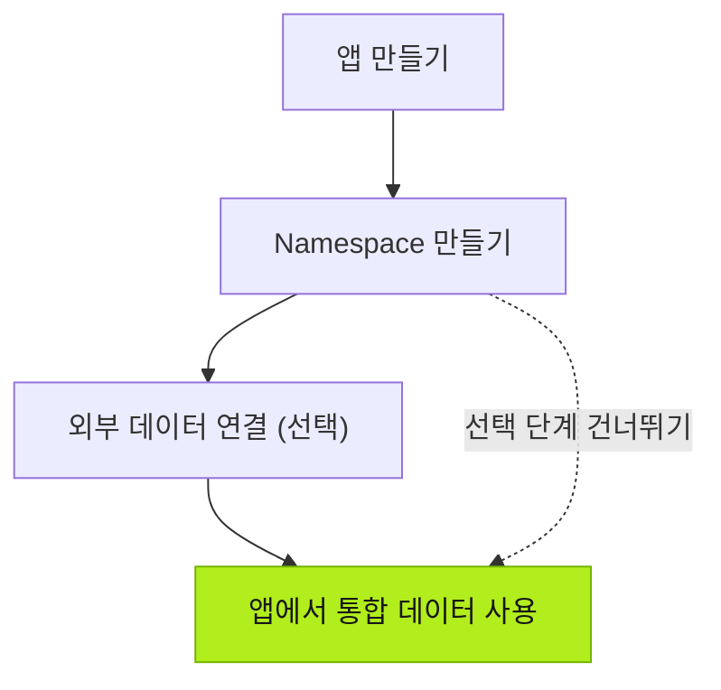

| 작업 | 담당자 | 설명 |
| --- | --- | --- |
| 앱 만들기 | 사용자 | Agent와 대화하여 맞춤형 앱을 만듭니다. |
| Namespace 만들기 | Agent | 앱의 비즈니스 로직에 따라 Namespace와 데이터 모델을 만듭니다. |
| 외부 데이터 연결 (선택) | 사용자 | 필요한 경우 Agent가 연결할 기존 비즈니스 시스템이나 장치의 정보를 제공합니다. |
| 데이터 통합 | Agent | 외부 데이터를 기존 앱 모델에 매핑하고 변환하여 통합합니다. |

## 다음 단계

- [앱 만들기](../../using-tier0/building-apps/) — Tier0에서 앱을 만드는 방법을 알아봅니다.
- [데이터 기반 준비](../../using-tier0/preparing-data-foundation/) — 데이터 모델과 외부 데이터 연결을 알아봅니다.
