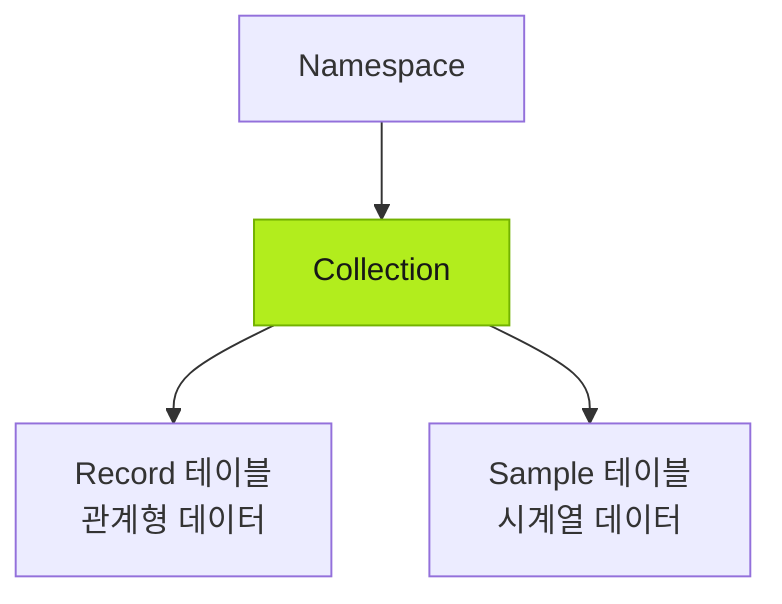
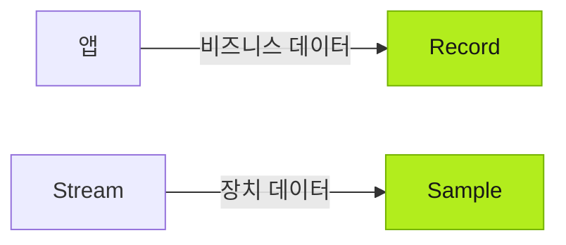
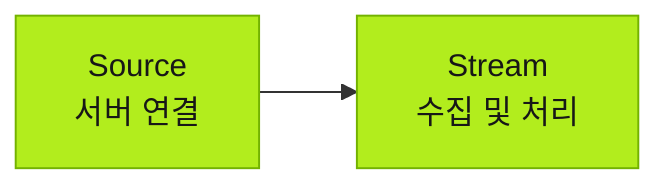

import { Steps } from '@astrojs/starlight/components';

Tier0는 맞춤형 앱을 위한 데이터 기반을 만듭니다. 앱의 비즈니스 데이터를 받고, 기존 시스템과 장치의 외부 데이터 소스를 연결하며, 앱이 사용할 수 있는 통합 모델로 데이터를 모읍니다.

:::tip[데이터 작업 담당]
- 데이터 소스 연결, 특히 인증이 필요한 연결은 사용자가 처리합니다.
- Agent는 데이터 수집, 매핑, 모델링 등 나머지 작업을 수행합니다.
:::

## 데이터 기반 개념

### Namespace

모든 데이터는 **Namespace** 아래 **Collections**에 모델링되고 데이터 유형별로 구성됩니다.

- 주로 비즈니스 시스템의 관계형 데이터는 **Record** 테이블에 저장합니다.
- 주로 장치의 시계열 데이터는 **Sample** 테이블에 저장합니다.

### 데이터 유형

비즈니스 데이터는 앱 사용이나 외부 시스템에서 올 수 있습니다. 시계열 데이터는 주로 연결된 장치에서 옵니다.

### 데이터 연결

- **Source**: 외부 데이터 서버에 연결하며 인증이 필요한 경우가 많습니다.
- **Stream**: 서버에서 데이터를 수집하고 요구사항에 맞게 처리하여 **Namespace** 모델에 저장합니다.

## 데이터 기반 구축

<Steps>
1. **Builder**에서 앱을 만들고 Agent가 **Namespace**에 비즈니스 데이터 모델을 준비하도록 합니다. 프롬프트에 명시하지 않으면 Agent가 앱의 비즈니스 로직에 맞춰 모델을 자동 생성합니다.
	:::note
	프롬프트에 명시하지 않으면 Agent가 앱의 비즈니스 로직에 맞춰 데이터 모델을 자동 생성합니다.
	:::
2. **Connect** > **Source**에서 필요한 데이터 소스를 연결하고 인증을 설정합니다.
3. Agent에게 **Stream**을 만들도록 요청하여 연결된 Source의 데이터를 수집·처리하고 앱에서 생성한 **Namespace** 모델에 저장합니다.
</Steps>

## 다음 단계

- [앱 만들기](../building-apps/) — UNS 데이터로 산업용 앱을 만듭니다.
- [공장 데이터 작업](../working-with-factory-data/) — 연결된 데이터를 읽고 사용합니다.
