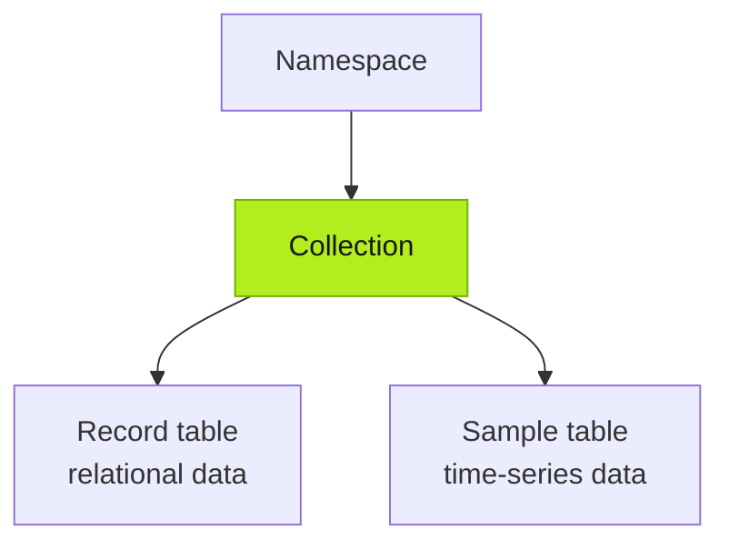
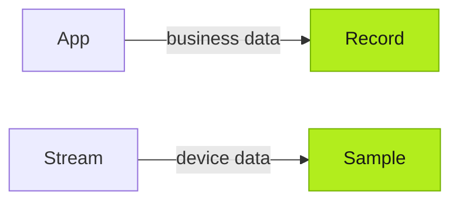
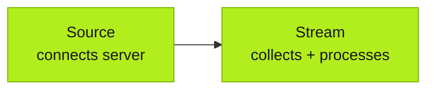

import { Steps } from '@astrojs/starlight/components';

Tier0 builds a data foundation for customized applications that:
- Takes in business data from applications;
- Connects external data sources from your existing systems and devices;
- Integrates data into a unified model for your applications to use.

:::tip[Who takes care of the data]
- Data source connections, especially ones that require authentication, are handled by you.
- The agent does the rest, including data acquisition, mapping and modeling.
:::

## Data Foundation Concept

### Namespace

All data is modeled into **Collections** under **Namespace** and organized based on data types.
- Relational data, mostly from business systems, is stored in **Record** tables.
- Time-series data, mostly from devices, is stored in **Sample** tables.

### Data Types

- Business data can be from application usage or external systems.
- Time-series data is mostly from connected devices.

### Data Connection

- **Source**: Connects to external data servers, frequently with authentications.
- **Stream**: Collects data from servers, processes it according to requirements and stores it in **Namespace** models.

## Building Data Foundation

<Steps>
1. Build your application in **Builder** and have the business data models prepared in **Namespace** using agent.

      :::note
      Unless stated clearly in the prompt, data models are automatically generated by the agent based on the application business logic.
      :::

2. Connect needed data sources under **Connect** > **Source** with authentication.
3. Tell the agent to create **Stream** to collect and process data from connected sources into **Namespace** models generated from the application.
</Steps>

## Next

- [Build Apps on UNS](../building-apps/) — Build industrial applications with UNS data.
- [Work with Factory Data](../working-with-factory-data/) — Read and use the data after connecting it to the UNS.

