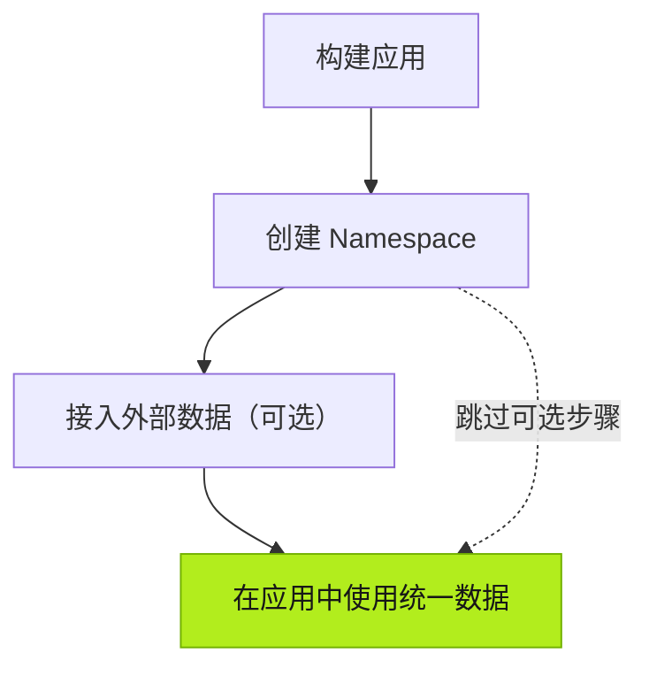

| 操作 | 执行者 | 说明 |
| --- | --- | --- |
| 构建应用 | 你 | 与 Agent 对话，创建自定义应用。 |
| 创建 Namespace | Agent | 根据应用的业务逻辑创建 Namespace 和数据模型。 |
| 接入外部数据（可选） | 你 | 如有需要，提供现有业务系统或设备的信息，供 Agent 连接。 |
| 集成数据 | Agent | 将外部数据映射、转换并集成到应用现有的数据模型中。 |

## 下一步

- [构建应用](../../using-tier0/building-apps/) — 了解如何在 Tier0 中构建应用。
- [准备数据基础](../../using-tier0/preparing-data-foundation/) — 了解数据模型和外部数据连接。
