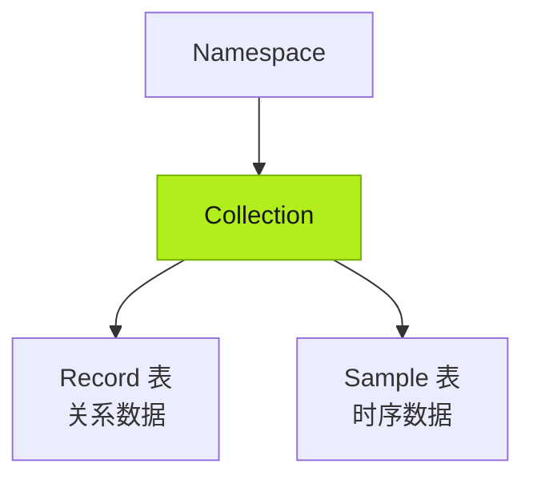
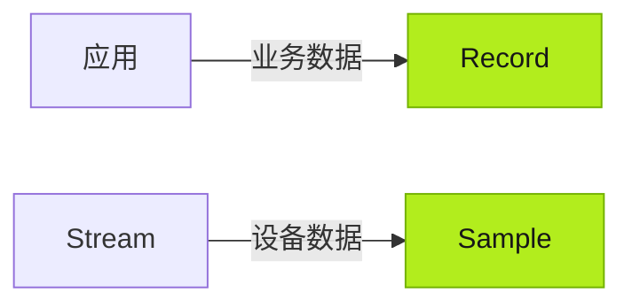
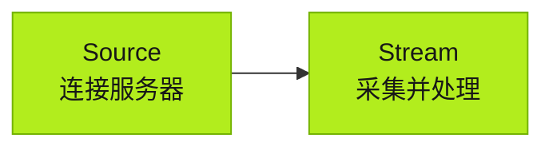

import { Steps } from '@astrojs/starlight/components';

Tier0 为自定义应用建立数据基础：接收应用业务数据、连接现有系统和设备的数据源，并将数据集成到统一模型供应用使用。

:::tip[数据工作由谁负责]
- 数据源连接，尤其需要认证的连接，由你处理。
- Agent 负责其余工作，包括数据采集、映射和建模。
:::

## 数据基础概念

### Namespace

所有数据都建模到 **Namespace** 下的 **Collections**，并按数据类型组织。

- 主要来自业务系统的关系数据存储在 **Record** 表中。
- 主要来自设备的时序数据存储在 **Sample** 表中。

### 数据类型

业务数据可来自应用操作或外部系统；时序数据主要来自已连接的设备。

### 数据连接

- **Source**：连接外部数据服务器，通常需要认证。
- **Stream**：从服务器采集数据，按需处理，并存入 **Namespace** 模型。

## 构建数据基础

<Steps>
1. 在 **Builder** 中构建应用，让 Agent 在 **Namespace** 中准备业务数据模型。除非 Prompt 明确指定，否则 Agent 会根据应用业务逻辑自动生成模型。
	:::note
	除非 Prompt 明确指定，否则 Agent 会根据应用业务逻辑自动生成数据模型。
	:::
2. 在 **Connect** > **Source** 中连接所需数据源并配置认证。
3. 让 Agent 创建 **Stream**，从已连接的 Source 采集和处理数据，写入应用生成的 **Namespace** 模型。
</Steps>

## 下一步

- [构建应用](../building-apps/) — 使用 UNS 数据构建工业应用。
- [操作工厂数据](../working-with-factory-data/) — 读取和使用已连接的数据。
